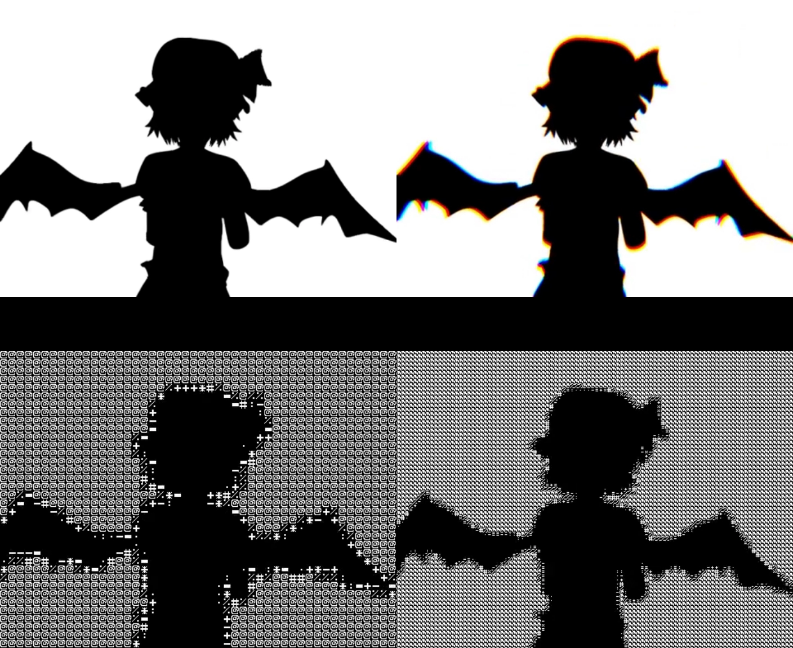
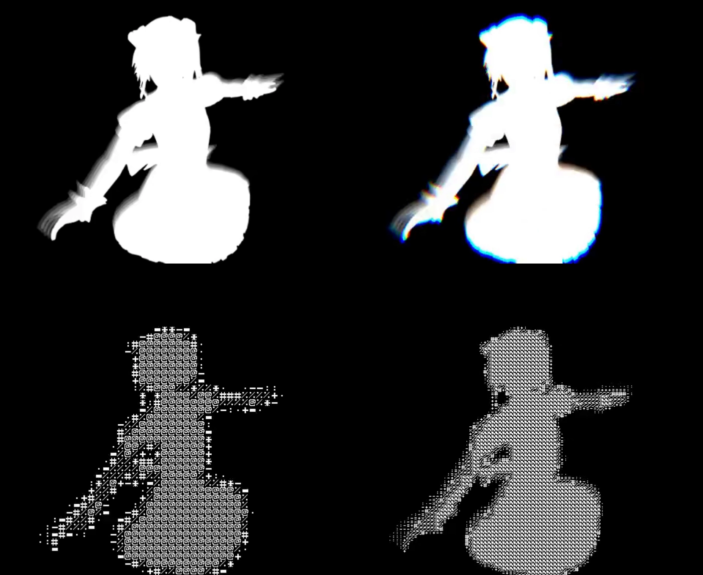

# Filtros de video con CUDA

Proyecto del Taller de Paralelismo en GPU. Es un programa de terminal que toma un video MP4, aplica un filtro cuadro a cuadro en una GPU NVIDIA y guarda el resultado en otro MP4. El proyecto también incluye un benchmark para comparar los tiempos de los filtros en CPU y GPU.

## Demo con Bad Apple!!

El montaje muestra una misma escena en cuatro paneles. Arriba se ve la versión en blanco y negro junto a la aberración cromática. Abajo aparecen los filtros ASCII de 10 × 10 y 5 × 5 píxeles, de izquierda a derecha. El tamaño del bloque determina el nivel de detalle de la silueta.



En esta otra escena se ven los mismos efectos sobre una silueta blanca con fondo negro.



## Cómo ejecutarlo

Necesitas una GPU NVIDIA compatible con el código que generes con CUDA, el compilador `nvcc`, `g++`, GNU Make y FFmpeg con soporte para codificar en H.264. Para compilar, también necesitas las cabeceras y bibliotecas de desarrollo de `libavcodec`, `libavformat`, `libavutil` y `libswscale`. El Makefile compila para `sm_75` por defecto. Si necesitas apuntar a otra arquitectura, puedes cambiarla con `CUDA_FLAGS=-arch=sm_XX`.

Ejecuta estos comandos desde la raíz del repositorio.

```bash
make ascii10
make grayscale INPUT=video_custom.mp4
```

`make ascii10` usa el `test.mp4` del repositorio y guarda el resultado en `test_ascii10.mp4`. El segundo comando toma el video indicado en `INPUT` y escribe `grayscale.mp4`. Los comandos de Make copian la primera pista de audio del video, así que el MP4 de entrada debe incluir audio.

| Comando | Efecto |
| --- | --- |
| `make grayscale` | Convierte el video a escala de grises. |
| `make ascii10` | Dibuja caracteres ASCII en bloques de 10 × 10 píxeles. |
| `make ascii5` | Dibuja caracteres ASCII en bloques de 5 × 5 píxeles. |
| `make posterization` | Reduce los niveles de color. |
| `make dither` | Usa un patrón de dithering al reducir los niveles de color. |
| `make chromatic` | Desplaza los canales rojo y azul hacia lados opuestos. |

## Benchmark CPU y GPU

```bash
make benchmark
```

El benchmark toma el primer fotograma del video y muestra el tiempo medio por filtro en milisegundos, junto con la razón entre el tiempo en CPU y el tiempo en GPU. La medición en GPU incluye la copia del fotograma hacia la tarjeta y la ejecución del filtro.
